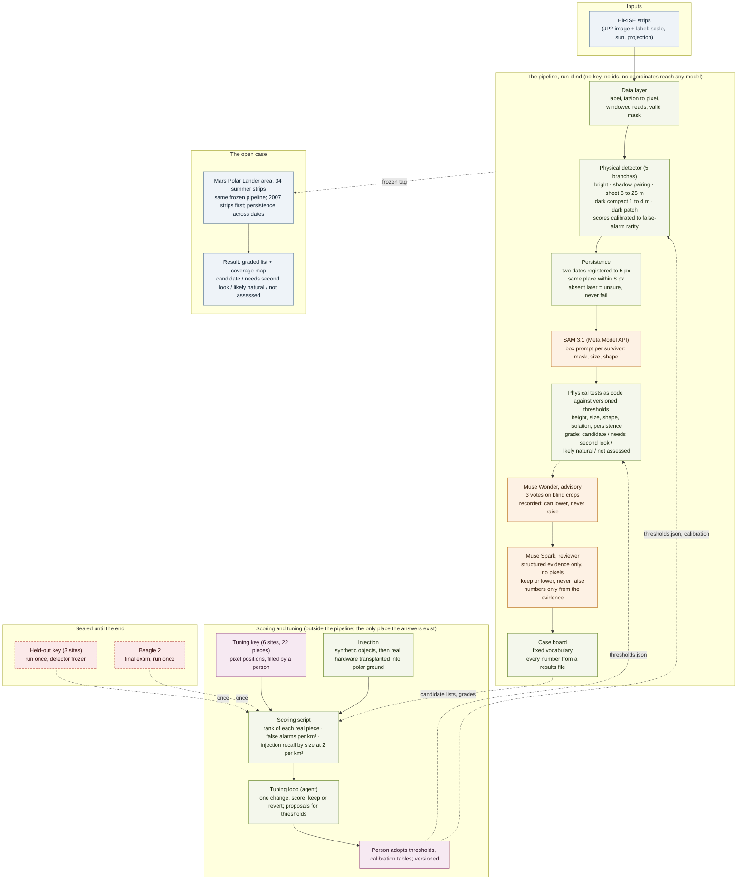

# Design: what the pipeline is and where the answers live

GitHub renders the diagram below from its source; `mmdc -i docs/design.md` is not needed.

## The pipeline, in order

Everything inside the yellow band runs blind: no answer key, no observation id, no coordinate and no date reaches
any stage, and every stage can only keep or lower a grade. The order is the one from the first plan: a physical
filter first, then SAM 3.1, then Muse Wonder, then Muse Spark. Nothing about it changed; what the last two days
added is the scoring machinery around it.

1. **Data layer** (built). Label parser, latitude and longitude to pixel for both HiRISE projections, windowed
   reads of the JPEG 2000 so a strip is never loaded whole, the valid-area mask.
2. **Physical detector** (built, v0.1). Five branches, each tagging its candidates: a bright compact object
   (1 to 10 m), a bright object with a shadow of the right length for this strip's sun angle, a bright flat sheet
   (8 to 25 m, the parachute), a dark compact object (1 to 4 m, backshell and heat shield), a dark patch (2.5 to
   50 m, a crash). Each branch's raw score is mapped to a common scale, minus log10 of that branch's false-alarm
   rate per km² on real ground, so one threshold means the same thing in every branch.
3. **Persistence** (built). Two dates of the same ground are registered by phase correlation (the labels alone
   disagree by tens of metres; after registration, 5 px). A candidate seen in the same place on both dates, within
   8 px, is persistent. Hard parts (lander, backshell, heat shield, fragments) must persist to become a
   candidate; sheets get a 50 m radius because fabric moves; absent on a later date is weak evidence (burial)
   and returns unsure, never fail.
4. **SAM 3.1** (not built; plan item 9). A box prompt per surviving candidate returns a mask, which gives the size
   and shape tests something better than a blob to measure. SAM supplies context, never a verdict.
5. **Physical tests as code** (built for the detector's own measurements; the mask-based versions come with
   SAM). Height from shadow length and sun angle, size, shape, isolation, persistence, each against a number in
   `controls/thresholds.json`, each pass, fail, unsure or not run. The decision table turns them into a grade:
   candidate (every core test passes and seen on two dates), needs second look, likely natural, not assessed.
6. **Muse Wonder, advisory** (not built; item 9). Three votes on augmented blind crops with reference crops from
   other sites. The vote is recorded and shown; it can lower a grade, never raise one. A recognition probe
   ("do you know this place?") runs first on the famous sites, and its answer goes on the board.
7. **Muse Spark, reviewer** (not built; item 9). Reads the structured evidence, never pixels, through tools that
   can list candidates, fetch one, read the thresholds, propose an exploratory check, and record a verdict that
   may keep or lower a grade and must cite evidence. Bounded follow-ups (a zoom pass, a second-date check, more
   votes) if time allows.
8. **Case board** (the renderer is built in the old draft and will be ported). Fixed vocabulary, every number
   traced to a results file, a coverage map of what was searched on how many dates.

## Who sees the answers

| what | detector and tests | SAM, Wonder, Spark | scoring script | tuning loop | person |
|---|---|---|---|---|---|
| tuning key (6 sites, pixel positions) | never | never | yes | only through the score | fills it |
| held-out key (3 sites) | never | never | once, at the end, detector frozen | never | fills it, keeps it out of the repo |
| Beagle 2 | never | never | once, last | never | triggers it |
| observation ids, coordinates, dates | in the data layer only | never, enforced by a leak check on every commit | in the results files | never | yes |
| thresholds and calibration tables | reads them | reads thresholds | reads them | proposes changes | adopts them, versioned |

So the answer to "are we giving them all the answers after the filter": no stage of the pipeline is ever given an
answer. The key is used in exactly one place, the scoring script, to grade a run that has already happened. What
the tuning loop sees is the grade, and what it changes is the detector's numbers; the models are never tuned
against the key at all, and their value is reported with and without them.

## How the key is used, and why not one site at a time

The alternative, reveal one answer, improve, reveal the next, is a cross-validation scheme. We do a
simpler split that gives the same protection with less bookkeeping:

- **Tuning sites (6).** All of their answers are available at once, from the moment the key is filled. The
  detector is tuned against them freely. One honest number survives even here: the baseline lists were produced
  and saved before the key existed, so the first score is a true blind result on the tuning sites.
- **Held-out sites (3).** Their answers are in a file the agent cannot read. The detector and its thresholds are
  frozen with a tag, the run happens once, and whatever comes out is the number. If something is fixed afterwards,
  the fix goes in a later tag and both numbers are shown.
- **Beagle 2.** Last, once, with the expectation written down first that a 1.5 m object may be missed.
- **Injection.** Hundreds of known answers for free: objects of known size placed in real tiles, scored as recall by
  size at a fixed false-alarm rate. First synthetic, then real hardware cut from the tuning strips and planted in
  polar ground from the search area. This is what the tuning loop mostly chases, so that six real sites cannot be
  memorised.

A learning curve is cheap to add if we want it: tune on 2, 4 and 6 sites and score the rest by leave-one-site-out
within the tuning set. It would show whether the detector keeps improving with more sites or has already fit the
quirks of the six. It is in the backlog, not on the critical path.

## What the models add, stated plainly

The detector and persistence do the volume and the physics. SAM makes the size and shape tests measure a real
outline instead of a blob. Wonder gives a second opinion from a vision model that has never been told where it is
looking, with its memorisation tested rather than assumed. Spark turns the evidence into a reviewed, cited verdict
and a board a person can read, and it is the agent in the system: it decides which bounded follow-up to order,
within caps, with every decision in the tool log. None of them can promote a candidate; all of them can demote
one. That is the shape that lets the result be defended to someone who has spent years on these images.

## The open case

The Mars Polar Lander search runs the frozen pipeline over the 34 summer strips, the 2007 strips first, with
persistence across every pair of dates that overlap. The result is a graded list and a coverage map. The grade
vocabulary is the result; there is no other kind of claim.
